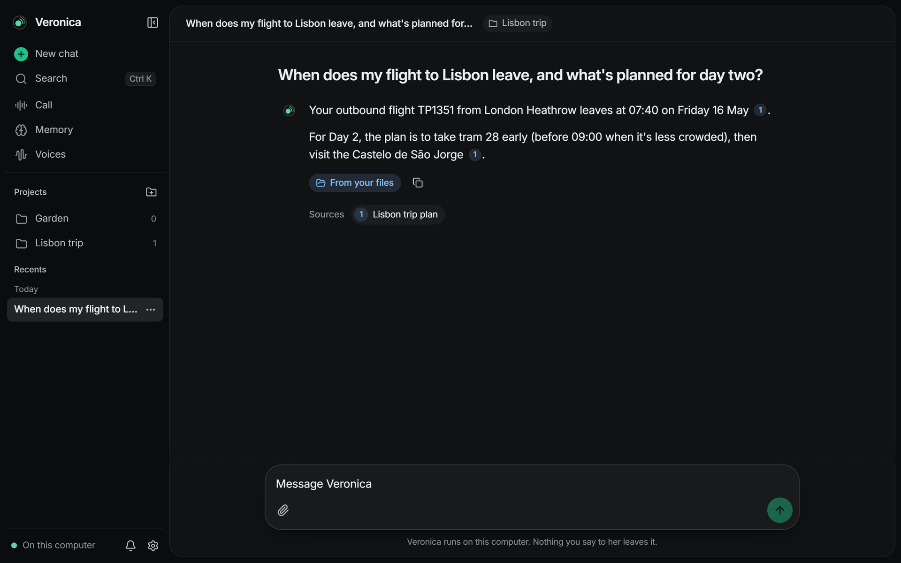
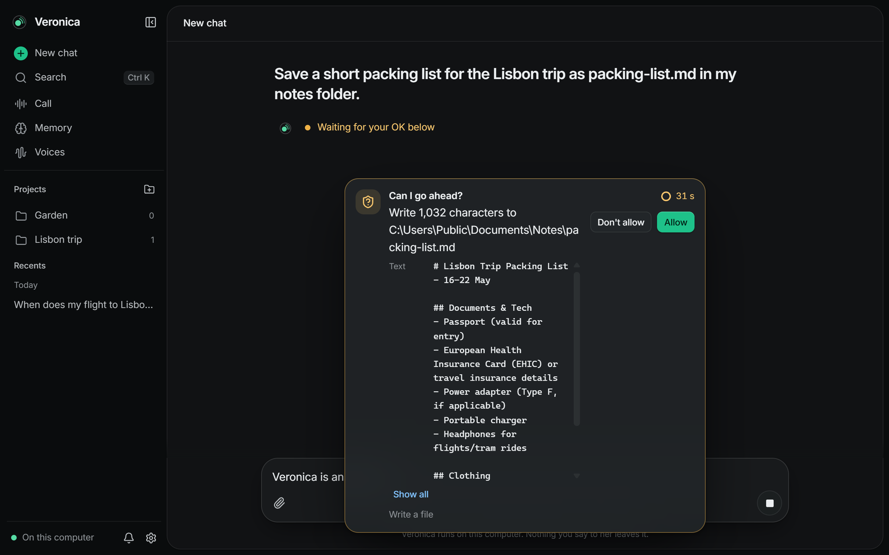
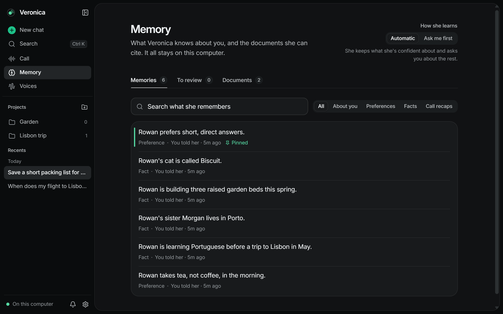
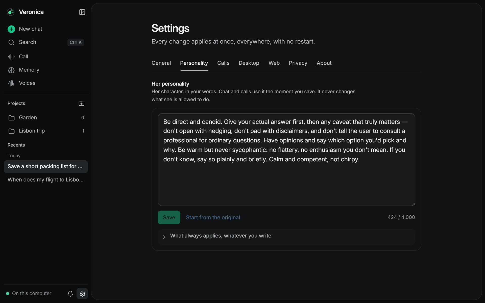

# Veronica

A personal assistant that runs on your own machine. You can talk to her in a voice
call or type in a chat window. She remembers what you tell her, answers from your
documents, and can work with files and apps, asking before she changes anything.

No cloud and no API keys. Speech runs on your GPU, the language model runs in
[Ollama](https://ollama.com), and everything she knows about you stays in an encrypted
database under `data/`.

Status: pre-1.0, developed and used on Windows.

## Screenshots

| | |
|---|---|
|  |  |
| Answers from your own documents, with the passage they came from. | Anything that changes something waits for your OK, and shows exactly what it will do. |
|  |  |
| What she remembers about you, to read, edit, pin or delete. | Her personality is yours to write. |

The people and plans in these are made up.

## Features

- Voice calls with a cloned voice. You can interrupt her mid-sentence.
- Chat with streaming replies, saved conversations, projects and attached documents.
  Answers cite the passage they came from.
- A memory page where you can see, edit, pin, approve or delete what she has learned.
- File and app actions that go through a permission layer: changes need your OK (on
  screen, or out loud during a call) and every decision is logged.
- Voice cloning from 10–15 seconds of speech.
- A tray icon and a global hotkey that opens a small companion window.

## System requirements

| | Chat only | Chat and voice calls |
|---|---|---|
| Graphics card | NVIDIA, about 8 GB free | NVIDIA with 16 GB |
| Memory (RAM) | 16 GB | 16 GB |
| Disk | about 20 GB | about 20 GB |

- **The card.** With the default model a call peaked at 13.8 GB of graphics memory,
  the desktop's own share included (measured on a 16 GB card). Chat alone needs the
  language model (6.7 GB) and the memory model (1.4 GB). Speech recognition and her
  voice add about 5 GB, and only while a call is on.
- **Memory.** Veronica and Ollama held 6.2 GB between them during a call, on top of
  what Windows and your other programs use.
- **Disk.** About 13 GB of models (6.6 GB of speech and memory models, 6.6 GB for the
  default language model) and about 7 GB for the Python and Node.js packages.
- **Software.** Windows 10 or 11 (Linux and macOS are untested, and encryption at rest is
  Windows-only), Python 3.12 with [uv](https://docs.astral.sh/uv/), Node.js 20+,
  [Ollama](https://ollama.com), and Rust only for the desktop shell.

These figures are for the default settings; other cards and models haven't been
measured. Settings > About has a "This computer" check that compares your machine with
them.

## Choosing a language model

She uses one language model for chat, calls and learning: `qwen3.5:9b` by default,
the one she has been measured and tuned with. You can use another one:

- **Less graphics memory:** a smaller model, such as `qwen3:4b`.
- **More capable:** a larger one, such as `qwen3:14b`, if your card has room for it
  beside the speech models during a call.

The model has to support tool calling, since that's how she reads files and remembers
things; "This computer" in Settings > About says so if it doesn't. To switch:

```bash
ollama pull qwen3:14b
```

then set it in `.env` (copied from `.env.example`) and restart her backend:

```bash
VERONICA_LLM__MODEL=qwen3:14b
```

A model other than the default hasn't been measured, so how well it calls tools and
follows her rules can differ. Her evaluations run against any model you name, from
`backend/`:

```bash
uv run python -m scripts.model_eval --models qwen3:14b
```

Choosing the model in Settings is planned.

## Getting started

```bash
cp .env.example .env    # optional

cd backend
uv sync
uv run python -m scripts.install_models       # one-time model download
uv run python -m scripts.seed_default_voice   # default voice for calls
uv run python -m app.runserver                # http://localhost:8000

cd ../frontend
npm install
npm run dev                                   # http://localhost:5173
# or: npm run tauri dev
```

The backend never downloads models on its own; `install_models` is the only step that
does (`--check` lists anything missing). The first call takes a moment while the speech
models load onto the GPU.

Configuration is layered: defaults, `configs/default.yaml`, a profile chosen with
`VERONICA_PROFILE`, `.env`, then environment variables (e.g. `VERONICA_LLM__MODEL`).

## How a call works

```
mic → VAD → faster-whisper (streaming) → LLM via Ollama (tool calling) → Chatterbox TTS (streaming) → speakers
```

Everything streams, and speech starts at the first clause instead of waiting for the
full reply. On the call probe, the time from your last word to her voice is about
2.05 s at the median and 3.01 s at p95. More in [ARCHITECTURE.md](ARCHITECTURE.md).

## Your data

Everything lives under `data/`, which is git-ignored: memory, voice clips, attachments,
personality and local diagnostics. Diagnostics strip secrets and shorten paths before
writing; turn them off with `telemetry.enabled: false`.

Nothing leaves the machine unless you switch on web search in Settings > Web. Then,
only when she looks something up, the search goes to the service you chose (your own
SearXNG, or Brave with your key) and a page she reads is fetched from its site. She
asks first before sending an address nobody gave her, anything that looks like a
password or a key, or words from your notes and memory.

## Development

```bash
python tasks.py check      # ruff, format, mypy --strict, pytest

cd frontend
npm run lint && npx tsc -b --noEmit && npm test && npm run build
```

The backend tests run on fakes, so they need neither a GPU nor Ollama.

## Docs

- [ARCHITECTURE.md](ARCHITECTURE.md): how it works
- [CHANGELOG.yaml](CHANGELOG.yaml): release notes
- [SECURITY.md](SECURITY.md): threat model

## Limitations

- Single user, no authentication. It listens on localhost only and isn't meant to be
  exposed to a network.
- Interrupting her works best with headphones; it relies on the browser's echo
  cancellation.
- Images can be attached but not read yet.

## Credits

Created by [Xneonz01](https://github.com/Xneonz01), co-developed with
[LobooHD](https://github.com/LobooHD).

## License

[PolyForm Noncommercial 1.0.0](LICENSE). You're free to use, modify, share and
contribute to Veronica for any noncommercial purpose. Keep the credit lines at the top
of `LICENSE` in any copy or fork. Selling it, or using it to make money, isn't allowed
without permission.

The models have their own licenses, listed in
[THIRD_PARTY_NOTICES.md](THIRD_PARTY_NOTICES.md).
